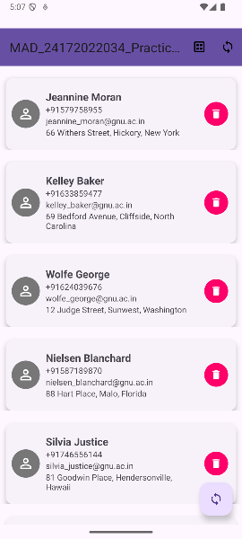
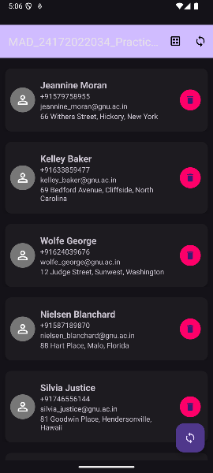

# MAD_24012011120_Practical-7: SQLite and JSON Practical

**Student Name:** Prince Patel  
**Enrollment No:** 24012011120  
**Institute:** U. V. Patel College of Engineering, Ganpat University  

---

## AIM
Develop an Android application that retrieves person data in JSON format from an internet API and stores the retrieved data in an SQLite database.

---

## Features
* **Remote JSON API Integration:** Fetches person details asynchronously from a remote endpoint using `HttpURLConnection` and Kotlin Coroutines.
* **JSON Parsing:** Robust parsing of nested JSON objects (`profile`, `location`, `contact`) into `Person` data models.
* **Local SQLite Database:** Uses `SQLiteOpenHelper` (`DatabaseHelper`) to perform full CRUD operations (Create, Read, Update, Delete) on local tables.
* **Dynamic RecyclerView:** Displays person cards with name, phone number, email, and address.
* **Data Synchronization:** Loads cached data instantly from local SQLite DB on startup and syncs updated data via FloatingActionButton.
* **Delete Functionality:** Users can tap the trash button on any card to delete the record from both the UI list and the local SQLite database.

---

## How to Use
1. **Launch App:** The app opens and immediately displays cached person records from SQLite.
2. **Fetch from API:** Tap the **Sync (FloatingActionButton)** in the bottom-right corner to fetch fresh person data from the JSON API. New records are saved to SQLite and updated in the list.
3. **Delete Record:** Tap the **Delete (Trash)** button next to any person's details to remove that record from SQLite and the list.

---

## Screenshots

| Light Theme | Dark Theme |
|:---:|:---:|
|  |  |
